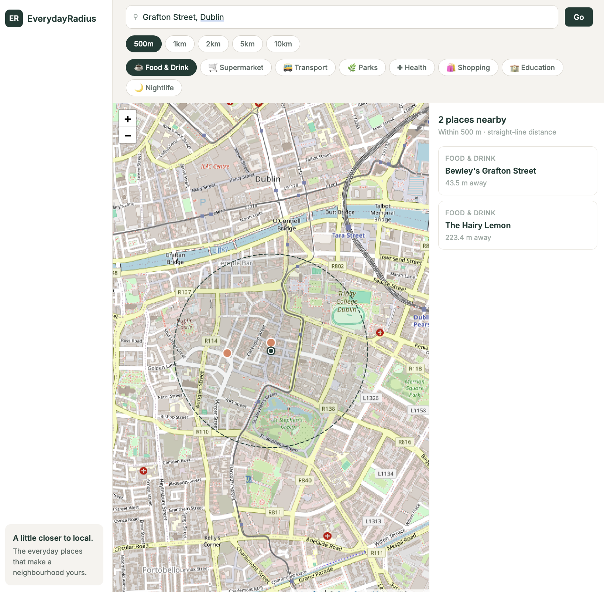
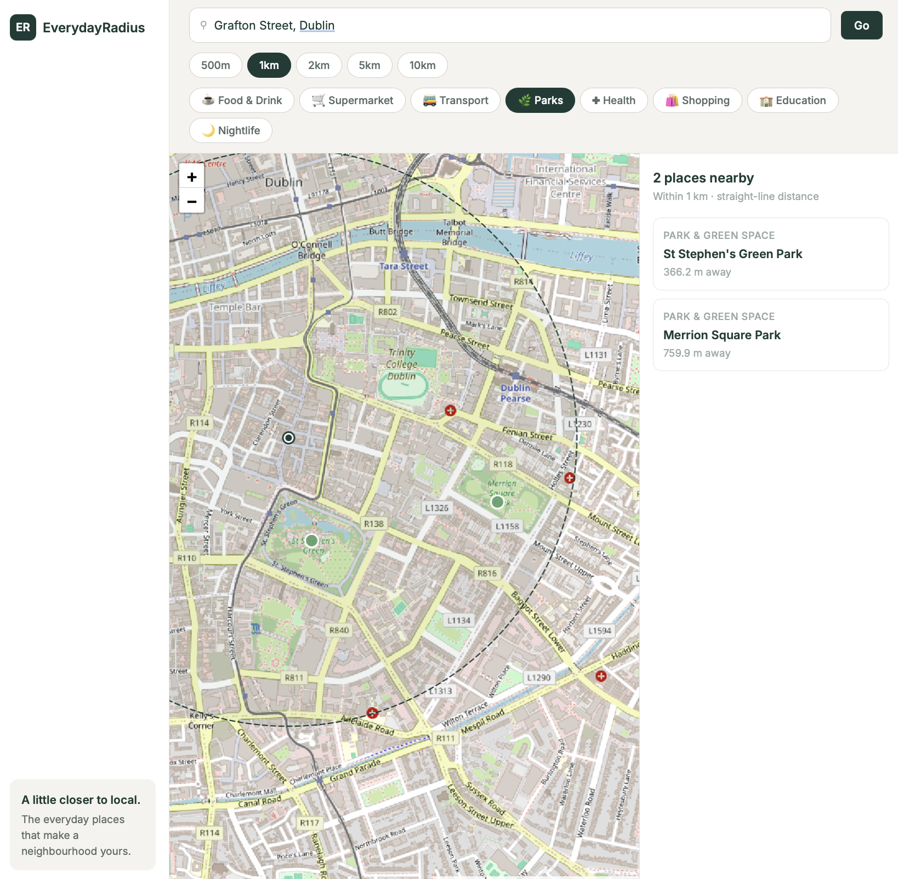
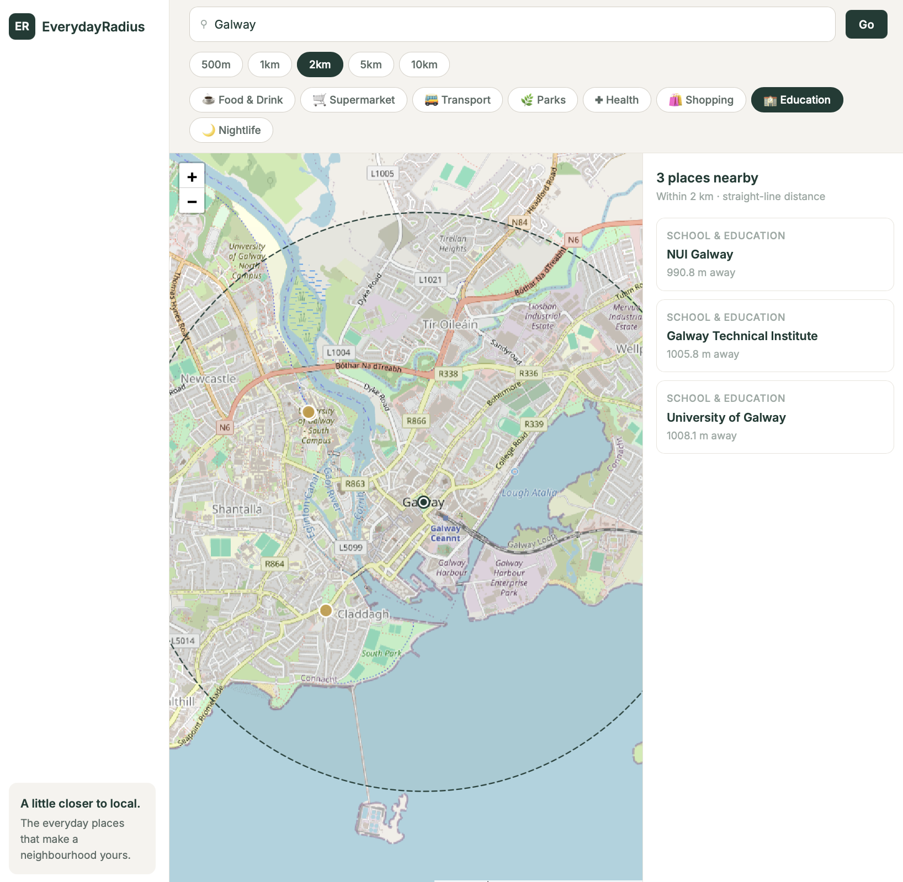
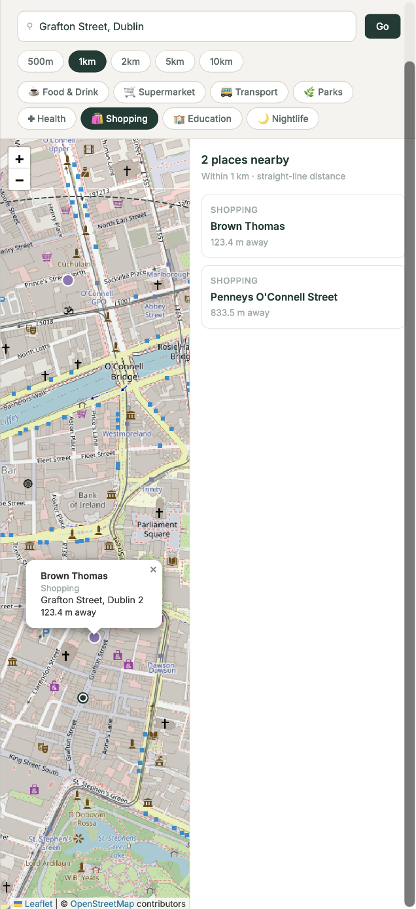

# EverydayRadius

> **Choose a place by the life around it.**

Finding a new apartment or choosing a hotel shouldn't mean opening five different apps to investigate the area. EverydayRadius lets you enter any address and instantly see the neighbourhood through your own priorities — food, transport, schools, nightlife, and more — all within a real spatial radius on a live map.

Especially useful when evaluating a place before committing to living there or staying there.

## Tech Stack

- **Backend:** Django 5.2, GeoDjango, Django REST Framework
- **Database:** PostgreSQL 16 + PostGIS 3.4
- **Frontend:** Leaflet.js, OpenStreetMap, Bootstrap 5
- **Deployment:** Docker Compose

## Setup Instructions

1. Clone the repository
2. Copy `.env.example` to `.env` and fill in your values
3. Run the application:
   docker compose up --build
4. Load sample data:
   docker compose exec web python manage.py load_sample_data
5. Open http://localhost:8000

**PgAdmin4** is available at http://localhost:5050

## How It Works - User Guide

1. Open http://localhost:8000 in your browser
2. **Search for a location** — type any address in Ireland into the search bar and click **Go** or click anywhere on the map. That point becomes the centre of your search radius.
3. **Choose what matters to you** — filter by category: food, supermarkets, transport, parks, shopping, schools, nightlife, or health.
4. **Explore a real spatial radius** — choose 500m, 1km, 2km, 5km or 10km. The radius is drawn on the map and PostGIS finds all matching places inside it.
5. **Compare the results** — nearby places appear in a list with category and distance. Click any result to open its map marker and popup.
6. **Manage the data** — full CRUD operations are available via the REST API and Django admin at http://localhost:8000/admin.

## Architecture

```
Browser (Leaflet JS + Bootstrap 5)
        |
        | HTTP requests (GeoJSON)
        v
Django Application (Gunicorn)
        |
        | GeoDjango ORM spatial queries
        v
PostgreSQL + PostGIS
```

- The browser fetches spatial data from Django REST API endpoints
- Django uses GeoDjango to run PostGIS spatial queries (radius, nearest, polygon)
- Results are returned as GeoJSON and rendered as Leaflet markers on the map
- All components run as separate Docker containers on an isolated network

## Database Schema

### PointOfInterest

| Field | Type | Description |
|---|---|---|
| id | AutoField | Primary key |
| name | CharField(200) | Name of the place |
| category | CharField(50) | One of: food, supermarket, transport, park, shopping, school, nightlife, health |
| address | CharField(300) | Street address (optional) |
| description | TextField | Short description (optional) |
| location | PointField(srid=4326) | Geographic coordinates (WGS84) |
| created_at | DateTimeField | Auto-set on creation |
| updated_at | DateTimeField | Auto-set on update |

## Spatial Queries

| Query | Endpoint | Method | Description |
|---|---|---|---|
| Proximity | `/api/pois/radius/` | GET | Finds POIs within a chosen radius using `distance_lte`, ordered by distance |
| Nearest places | `/api/pois/nearest/` | GET | Returns the N closest POIs using `annotate(Distance).order_by` |
| Spatial containment | `/api/pois/within-polygon/` | POST | Finds POIs inside a GeoJSON polygon using `location__within` |

## API Endpoints

| Endpoint | Method | Description |
|---|---|---|
| `/api/pois/` | GET | List all POIs |
| `/api/pois/` | POST | Create a new POI |
| `/api/pois/<id>/` | GET | Retrieve a single POI |
| `/api/pois/<id>/` | PUT/PATCH | Update a POI |
| `/api/pois/<id>/` | DELETE | Delete a POI |
| `/api/pois/radius/?lat=&lon=&radius=&category=` | GET | POIs within radius (km) |
| `/api/pois/nearest/?lat=&lon=&limit=` | GET | Nearest N POIs |
| `/api/pois/within-polygon/` | POST | POIs inside a GeoJSON polygon |

## Known Issues

- Geocoding is scoped to Ireland; addresses outside Ireland may not resolve correctly.
- Sample data covers Dublin, Cork, Galway, Limerick and Waterford only — searching other areas will return no results.

## Screenshots

**Dublin — Food & Drink within 500m of Grafton Street**


**Dublin — Parks within 1km of Grafton Street**


**Galway — Education within 2km**


**Dublin — Mobile responsive view**


